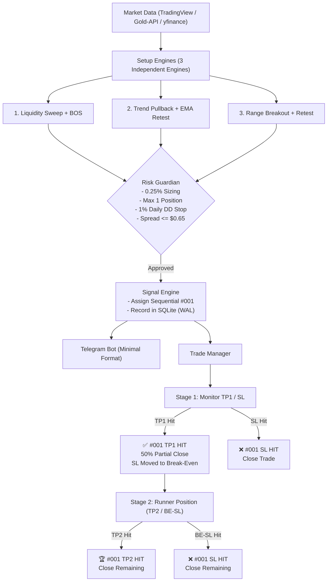

# 🏆 Gold QuickScalp AI — Adaptive TP/SL Scalping System
### Commander A Specification — XAUUSD Only

Gold QuickScalp AI is a selective, high-expectancy algorithmic scalping bot specifically engineered for **XAUUSD (Gold Spot / CFD)**. It focuses on short, realistic price movements, continuous 24/7 market monitoring, and positive net expectancy after all real-world trading costs (spread, commissions, and slippage).

---

## 📌 1. Core Objectives & Philosophy

- **Realistic Market-Structure Scalping:** Prioritizes high-probability, short price swings over uncalibrated long-shot targets. Never promises a 90% win rate or claims any target is certain to be hit.
- **Three Independent Setup Engines:**
  1. **Liquidity Sweep + BOS:** Identifies buy-side and sell-side liquidity grabs on M15/M5 followed by confirmed Break of Structure (BOS) and M1 candle close execution.
  2. **Trend Pullback + EMA 20/50 Retest:** Trades with the M15 trend (EMA 50 / EMA 200) on pullbacks into the M5 EMA 20/50 value area with M1 confirmation.
  3. **Range Breakout + Retest:** Identifies consolidation ranges on M15, confirms genuine breakouts on M5, and entries on boundary retest holds.
- **Adaptive TP & SL Lifecycle:**
  - **TP1 (Target 1):** Nearest logical market-structure level (opposing swing high/low, FVG, or S/R). Triggers partial position close (50%) and automatically moves Stop Loss to Break-Even.
  - **TP2 (Target 2):** Extended structural target for remaining runner position.
  - **Conservative Execution Rule:** If a single candle touches both TP and SL, conservative adverse execution rules apply. Never reports dual final outcomes for the same position.
- **Continuous 24/7 Monitoring:**
  - Operates 24/7 whenever valid market data is available. No session restrictions (London or New York).
  - Enforces spread, data freshness, and volatility checks at all times.
  - News risk is logged as a warning; it does not silently kill trading solely because of the clock.
- **Strict Capital Protection (Commander A):**
  - Default risk per trade: **0.25%** of equity (absolute ceiling: **0.50%**).
  - Maximum simultaneous positions: **1 position**.
  - Initial daily drawdown stop: **1.0%** of equity.
  - No martingale, grid, or averaging down.

---

## 📱 2. Minimal Telegram Message Specification

Telegram messages are stripped of all analysis, marketing text, daily reports, and unnecessary warnings. Application logs retain full diagnostics.

### Signal Messages
```text
🟢 BUY #001 Entry: 2685.50 TP1: 2690.00 TP2: 2694.50 SL: 2681.00
🔴 SELL #002 Entry: 2685.50 TP1: 2681.00 TP2: 2676.50 SL: 2689.50
```

### Trade Outcome Messages
```text
✅ #001 TP1 HIT
🏆 #001 TP2 HIT
❌ #001 SL HIT
```

---

## 🏗️ 3. Architecture Overview



---

## ⚙️ 4. Quick Start & Operating Modes

### Prerequisites
- Python 3.12+
- Dependencies installed via `pip install -r requirements.txt`

### Configuration (`.env`)
```bash
OPERATING_MODE=PAPER          # BACKTEST, PAPER, or TELEGRAM_SIGNAL
TELEGRAM_BOT_TOKEN=your_bot_token
TELEGRAM_CHAT_ID=your_chat_id
RISK_PER_TRADE=0.25
MAX_DAILY_LOSS_PCT=1.0
MAX_SPREAD_ALLOWED=0.65
```

### Running the System
```bash
# 1. Run live continuous paper monitoring
python main.py

# 2. Run historical performance backtest
python run_backtest.py

# 3. Run complete test suite
python -m pytest tests/ -v
```

---

## 🤖 5. Telegram Commands

- `/start`: Check bot status, current Gold price, and operating mode.
- `/status`: Displays active trade (if any), today's PnL, and current risk metrics.
- `/reset`: Clears risk halts and resumes trading.

---

## ⚖️ 6. Disclaimer

Automated live order execution is permanently disabled by default. All operations run in simulated paper trading mode unless authorized and independently audited. Scalping involves inherent market risk; past backtest performance does not guarantee future results.
